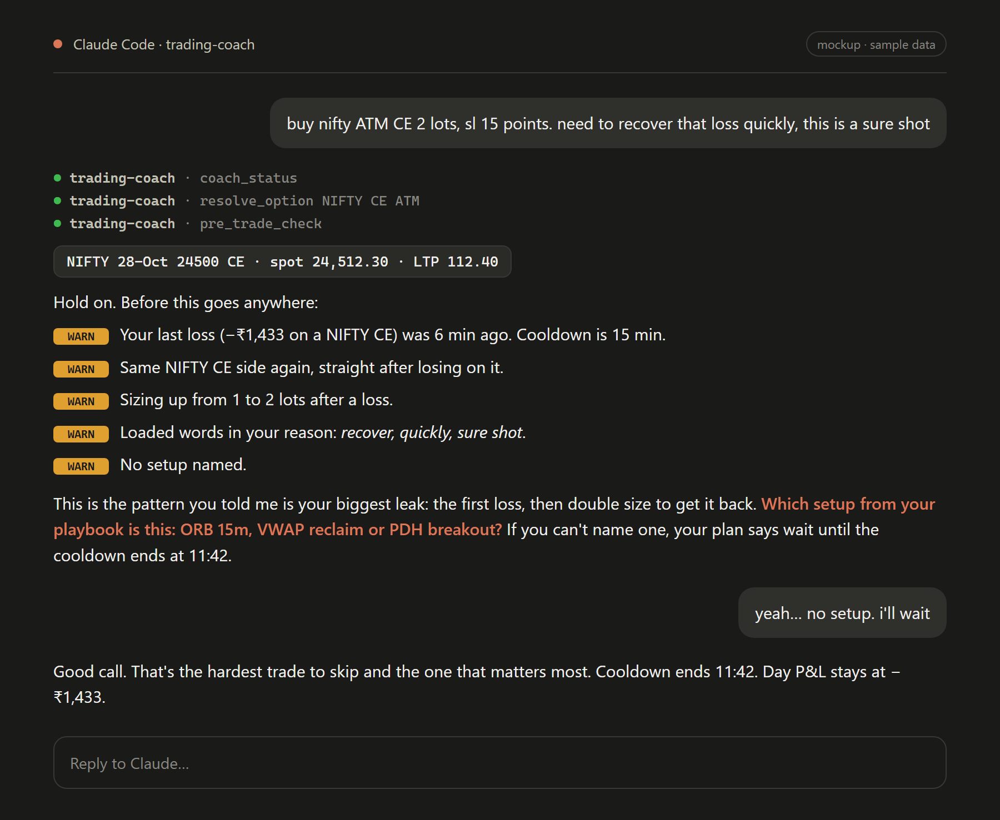
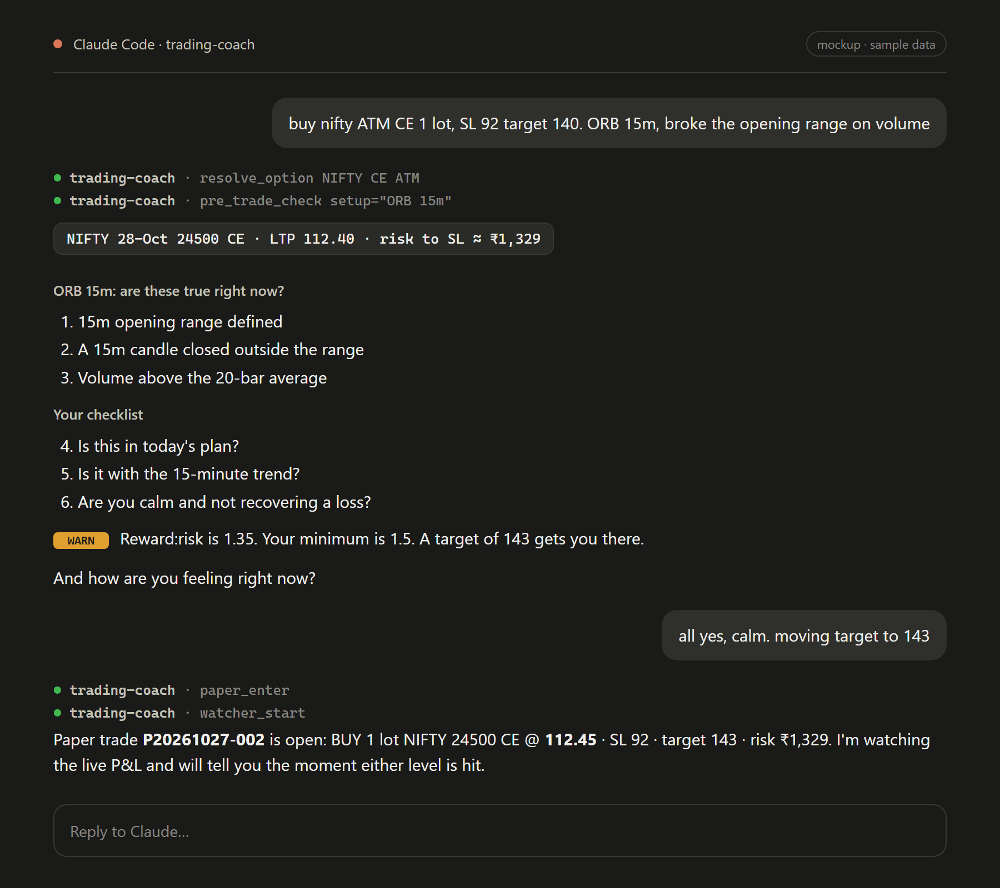
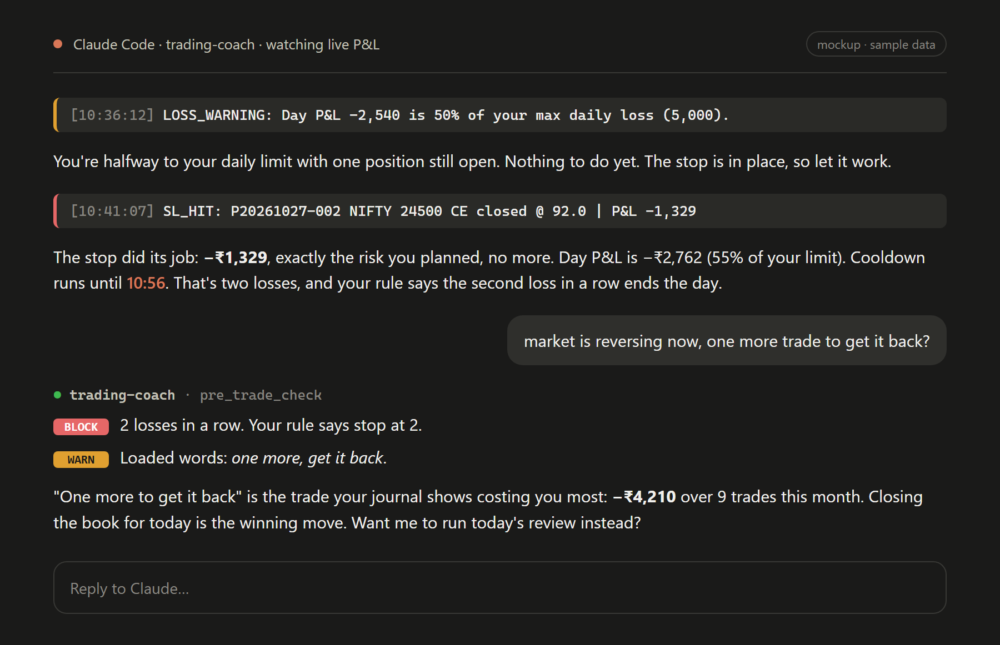
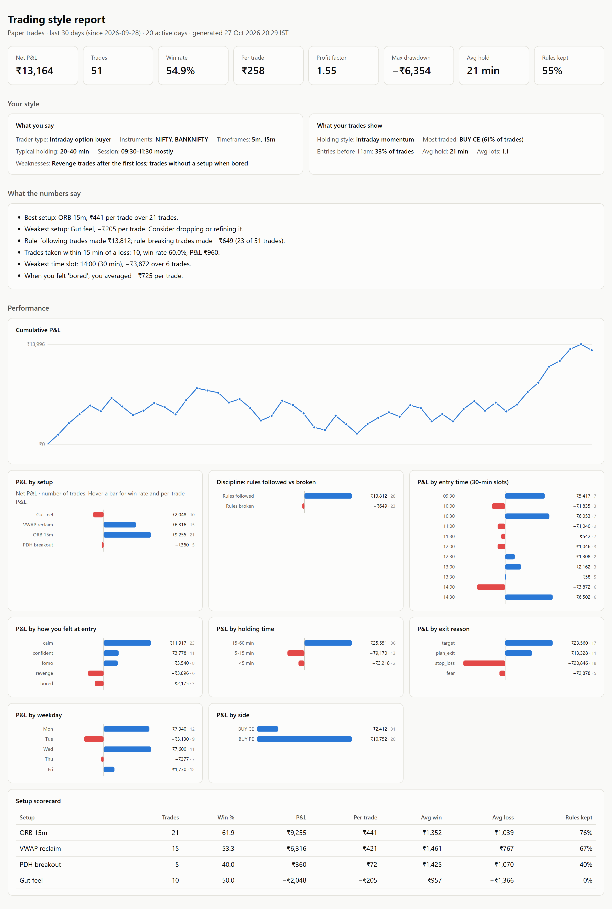

# Trading Coach: a Claude plugin for discretionary traders

**Install:** `/plugin marketplace add sekhar14/trading_utils` → `/plugin install trading-coach@trading-utils` → `python -m pip install "kiteconnect>=5.2,<6"` ([full setup](#1-requirements))

A discipline coach that sits between you and your trade. You type what you want to do in plain
English ("buy NIFTY ATM CE, 1 lot, SL 90, because 15-min breakout"), and before anything happens the coach:

- resolves it into a real contract with **live Zerodha Kite prices** (spot, strike, expiry, LTP, lot size)
- checks it against **your own rules**: trades per day, daily loss, losses in a row, cooldown after a
  loss, max lots, max risk, reward:risk, trading window, stop-loss required
- spots **overtrading and emotional patterns**: revenge trades, same-side re-entry after a loss,
  sizing up after a loss, rapid-fire trades, loaded words like "recover", "sure shot", "missed"
- asks your **pre-trade checklist** ("Is this in my plan?", "Am I calm?") and how you feel
- records a **paper trade** and **streams its P&L tick by tick** over Kite's WebSocket, auto-exiting at
  your stop-loss or target the moment a tick crosses it and warning you as the day's loss approaches your limit
- gives an end-of-day **review**: how your P&L differs when you follow your rules vs when you break them
- learns your **trading style and setup playbook**, tags every trade with its setup, and builds
  **visual analytics** showing which setups, times of day and states of mind actually make you money

## See it in action

> These are mockups built with **sample data** to show the experience. Your own numbers come from your paper trades.

**1. A revenge trade gets caught.** Six minutes after a loss, the trader wants double size on the same
side "to recover quickly". The coach names the pattern and asks for the setup.



**2. A clean trade.** The coach checks the setup's own criteria and your checklist, flags a weak
reward:risk, then opens a paper trade at the live price.



**3. Live P&L listening.** The watcher streams events into the chat. The coach reacts when the stop
hits and holds the line on your daily rules.



**4. Your trading-style report.** What you *say* your style is vs what your trades *show*, P&L by setup,
time slot, emotion, holding time and exit reason, and the cost of breaking your own rules.
Open [trading-coach/docs/sample-style-report.html](trading-coach/docs/sample-style-report.html) in a browser to explore it (hover the charts).



> **Paper trading only.** The plugin uses Zerodha's official `kiteconnect` SDK for login, quotes,
> instruments and the KiteTicker price stream, and contains no order-placement code. Nothing is ever sent to your broker. The coach judges your *process*. It never
> tells you what to buy or sell and is not investment advice.

---

## Contents
1. [Requirements](#1-requirements)
2. [Install the plugin](#2-install-the-plugin)
3. [One-time Zerodha Kite setup](#3-one-time-zerodha-kite-setup)
4. [Daily login](#4-daily-login)
5. [Set your rules](#5-set-your-rules)
6. [Taking a trade: the flow](#6-taking-a-trade-the-flow)
7. [Live P&L watching](#7-live-pl-watching)
8. [Your trading style and setups](#8-your-trading-style-and-setups)
9. [Style analytics](#9-style-analytics)
10. [Commands](#10-commands)
11. [What the coach checks](#11-what-the-coach-checks)
12. [Using it without Kite (manual prices)](#12-using-it-without-kite-manual-prices)
13. [Using it in Claude Desktop](#13-using-it-in-claude-desktop)
14. [Where your data lives](#14-where-your-data-lives)
15. [Troubleshooting](#15-troubleshooting)

---

## 1. Requirements

| Need | Notes |
|---|---|
| Claude Code (CLI, desktop Code tab or IDE) | Plugins and live event streaming work here. Claude Desktop chat works too (see §13). |
| **Python 3.9 or newer** | Runs the plugin. See below. |
| **`kiteconnect` package** | Zerodha's official SDK: login, quotes and the WebSocket tick stream. One `pip install`, below. |
| Zerodha Kite Connect app | For live prices. Must be a **Connect** (paid) app; setup in §3. Without it, use manual prices (§12). |

### Step 1: install Python

| OS | Install |
|---|---|
| Windows | Download from [python.org/downloads](https://www.python.org/downloads/). In the installer, **tick "Add python.exe to PATH"**. Or run `winget install Python.Python.3.12` |
| macOS | `brew install python` (or the python.org installer) |
| Linux | Usually preinstalled. Otherwise `sudo apt install python3 python3-pip` / `sudo dnf install python3 python3-pip` |

Open a **new** terminal and check:

```bash
python --version
```

It should print `Python 3.9` or newer. If it says *not found*, or opens the Microsoft Store on Windows,
Python is not on `PATH`: re-run the installer and tick the PATH box.

> **macOS/Linux:** if only `python3` works, use `python3` in the commands below, and edit
> `trading-coach/.mcp.json` to change `"command": "python"` to `"command": "python3"`.

### Step 2: install the dependency

The plugin's only third-party dependency is **[kiteconnect](https://github.com/zerodha/pykiteconnect)**,
Zerodha's official Python SDK. It brings in `requests` and the WebSocket stack used for live ticks
(`Twisted`, `autobahn`, `pyOpenSSL`, `service-identity`).

```bash
python -m pip install "kiteconnect>=5.2,<6"
```

(From a clone of this repo, `python -m pip install -r trading-coach/requirements.txt` does the same.)

> **Use the same Python that runs the plugin.** Claude starts the plugin with the `python` on your
> `PATH`, so install with `python -m pip`, not a bare `pip` that may belong to another Python.
> Virtual environments: point `"command"` in `trading-coach/.mcp.json` at the venv's python
> (e.g. `C:\venvs\trading\Scripts\python.exe` or `/home/you/venvs/trading/bin/python`).

### Step 3: check your setup

Run the built-in **setup checker**. It verifies Python, `kiteconnect`, the data folder, your Kite
config, network access to Kite and the login port, and never prints your secrets:

```bash
python trading-coach/server/doctor.py
```

```
[ OK ] Python 3.12.10
[ OK ] Plugin modules import
[ OK ] kiteconnect 5.2.2 installed (REST + WebSocket streaming)
[ OK ] Data folder writable: C:\Users\you\.trading-coach
[WARN] Kite API key missing
       -> Add kite_api_key to ...\.trading-coach\config.json (README section 3).
[ OK ] api.kite.trade reachable
[ OK ] Login redirect port 5678 free
```

Fix any `FAIL`. A `WARN` about Kite just means you haven't finished §3–4 yet.

## 2. Install the plugin

From Claude Code:

From GitHub:

```
/plugin marketplace add sekhar14/trading_utils
/plugin install trading-coach@trading-utils
```

Or from a local clone, use the folder that contains `.claude-plugin/marketplace.json`:

```
/plugin marketplace add C:\path\to\trading_utils
/plugin install trading-coach@trading-utils
```

Restart Claude Code when asked, then run `/mcp`. You should see `trading-coach` connected.
To get updates later: `/plugin marketplace update trading-utils`.

## 3. One-time Zerodha Kite setup

You need a Kite Connect **developer app** that can read live prices. This takes about 10 minutes, once.

### 3.1 Pick the right app type

Kite's developer console offers two app types. Only one can read prices:

| App type | Live quotes (LTP) & instrument list | Cost | Works with this plugin |
|---|---|---|---|
| **Connect** | Yes | Paid monthly subscription | **Yes, choose this one** |
| **Personal** | No (orders/portfolio only) | Free | No. Quote calls fail, so use manual prices (§12) |

Pricing and plan contents change from time to time, so confirm on
[developers.kite.trade](https://developers.kite.trade) and Zerodha's
[Kite Connect pricing page](https://kite.trade) before paying.

### 3.2 Create the app

1. Open [developers.kite.trade](https://developers.kite.trade) and **sign up**. This is a separate developer
   account from your Kite trading login. Verify your email.
2. **Add credits** to the developer account (Billing). The Connect subscription is paid from these credits.
3. Click **Create new app** → choose **Connect** and fill in:

   | Field | What to enter |
   |---|---|
   | App name | Anything, e.g. `trading-coach` |
   | Zerodha Client ID | Your Kite user ID (e.g. `AB1234`) |
   | Redirect URL | `http://127.0.0.1:5678/kite/callback` (exactly this) |
   | Postback URL | Leave empty. Order updates are not used. |
   | Description | e.g. `Personal paper-trading coach, market data only` |

4. Save. The app page now shows your **API key** and **API secret**.

### 3.3 About "read-only"

Kite has **no read-only permission setting**. An API key plus that day's access token can technically
call any Kite endpoint, including order placement. Read-only here is enforced by this plugin:

- `trading-coach/server/coach/kite.py` only uses the SDK's `login_url`, `generate_session`, `ltp`,
  `instruments` and `KiteTicker`. There is no order code in the project, which you can verify:
  `grep -rn "place_order\|modify_order\|cancel_order" trading-coach/server` finds nothing.
- Treat the **API secret like a password**. Anyone with it plus your login can trade on your account.
  Keep it out of chats, screenshots and git (the repo's `.gitignore` already excludes `config.json`).
- If the secret ever leaks, **regenerate it** from the app page on developers.kite.trade.
- Market-data-only use doesn't need the static IP whitelisting that SEBI's rules require for API
  **order** placement. If you later build real order placement, check Zerodha's current requirements first.

### 3.4 Put the key and secret on your machine

Copy the app's **API key** and **API secret** into `~/.trading-coach/config.json`
(on Windows: `C:\Users\<you>\.trading-coach\config.json`). Create the file if it doesn't exist.
The redirect port is configurable via `kite_redirect_port`, which must match the app's Redirect URL:
   ```json
   {
     "kite_api_key": "your_api_key",
     "kite_api_secret": "your_api_secret"
   }
   ```
   Or set environment variables `KITE_API_KEY` and `KITE_API_SECRET` instead.

Type these in yourself. Don't paste your secret into the chat. The file stays on your machine and is
only sent to `api.kite.trade` to create the daily session.

## 4. Daily login

Kite access tokens expire every morning (~6 AM). Once per trading day:

```
/trading-coach:login
```

Claude gives you a Zerodha login link. Open it and log in on **Zerodha's own page** (Claude never
sees your password or TOTP). Kite redirects to `127.0.0.1`, the plugin catches it and you're done.
If the redirect page doesn't load, paste the URL your browser ended on back into the chat.

## 5. Set your rules

```
/trading-coach:rules
```

Defaults you'll probably want to change:

| Limit | Default | Meaning |
|---|---|---|
| `max_trades_per_day` | 3 | Trades allowed per day |
| `max_daily_loss` | 5000 | ₹ loss (realized + open) at which the day is over |
| `max_consecutive_losses` | 2 | Stop after this many losses in a row |
| `cooldown_minutes_after_loss` | 15 | Revenge-trade window after any loss |
| `max_lots_per_trade` | 2 | Lots per trade |
| `max_open_positions` | 1 | Simultaneous positions |
| `max_risk_per_trade` | 2000 | ₹ lost if stop-loss hits |
| `min_reward_risk` | 1.5 | Target distance ÷ stop distance |
| `trading_window` | 09:30–15:00 | IST |
| `require_stop_loss` | true | No SL, no trade |
| `no_size_up_after_loss` | true | Warn when lots increase after a loss |
| `auto_square_off_on_daily_loss` | true | Watcher closes everything at the daily limit |

Change them in plain English:

```
/trading-coach:rules max 2 trades a day and stop after 3000 loss
/trading-coach:rules add: I only trade after the first 15-minute candle closes
```

**Checklist rules** are yes/no questions asked before every entry. Write them so **YES = rule
followed**. Answering NO doesn't stop the trade, but it's recorded as a rule break and shows up in
your review.

## 6. Taking a trade: the flow

Just talk to Claude:

```
buy nifty ATM CE 1 lot, SL 85, target 140. 15-min breakout above day high with volume
```

What happens:

1. **Resolve.** `NIFTY 28-Oct 24500 CE · spot 24,512 · LTP 112.40 · lot size from Kite`
2. **Check.** Flags are shown, hard-rule breaks (**BLOCK**) first, then behaviour warnings (**WARN**).
3. **Checklist.** Your yes/no rules plus "how are you feeling?"
4. **Coach call.**
   - A **BLOCK** means you're breaking your own rule. The coach recommends not taking it. To go ahead
     anyway you must type an override reason in your own words, and it's recorded.
   - A **WARN** gets one direct question, e.g. *"You lost on a CE 6 minutes ago and now want the same
     CE with 2 lots. Is this the setup, or getting the money back?"*
5. **Paper fill** at live LTP plus 1 tick of slippage. The live P&L watcher starts automatically.

Exiting: `exit my nifty trade` or `close all`. The coach asks briefly *why* (plan, fear, bored, time),
because that shows up in your review.

Useful phrasing:
- strike: `ATM`, `ATM+1` / `ATM-2` (steps along the strike ladder), or a number like `24500`
- expiry: nearest weekly by default, or `next`, or a date `2026-11-04`
- SL/target are **option premium** levels. If you say `SL 20%` or `SL 25 points`, the coach converts
  and shows you the number.

## 7. Live P&L watching

When a paper position opens, a background watcher connects to **Kite's WebSocket (KiteTicker)** and
subscribes to that option's ticks. Prices are **pushed** as they trade, with no polling, and every tick is
checked immediately:

- **auto-exits at your stop-loss or target** the moment a tick crosses it (at your level, or at the tick
  price if it jumped through)
- warns at **50% and 80%** of your max daily loss, and at **100%** closes everything (if
  `auto_square_off_on_daily_loss`) and tells you the day is over
- subscribes to new positions and unsubscribes from closed ones automatically
- reconnects by itself after network drops. If Kite rejects the session (tokens reset daily), it
  tells you to log in, and **restarts automatically after `/trading-coach:login`** if positions are still open

**In Claude Code**, the coach streams these events into the conversation using the Monitor tool,
so it reacts the moment your SL hits ("Stop did its job: −1,850. Cooldown until 11:42."). Start it
manually anytime with:

```
/trading-coach:watch
```

The watcher keeps running if you close Claude, and stops by itself about 2 minutes after your last
position closes. Ask "stop the watcher" to stop it sooner.

## 8. Your trading style and setups

The coach keeps a **profile** of how you trade, in your own words, plus a **playbook** of your named setups.

```
/trading-coach:profile
```

On first use it asks a few short questions: what kind of trader you are, which instruments, which chart
timeframes, how long you usually hold, your session, and the mistake you repeat most. Then it asks for
your setups, each with concrete criteria:

```
/trading-coach:profile add setup "ORB 15m": 15m opening range defined, candle closes outside it, volume above 20-bar average
```

How it's used:
- **Every trade is tagged with a setup.** If you don't name one, the coach asks (`NO_SETUP`). If it isn't in
  your playbook, you get an `OFF_PLAYBOOK` warning. Trading an underlying outside your stated
  instruments gets `OFF_STYLE_INSTRUMENT`.
- **Setup criteria become questions.** Before entry, the coach asks whether each criterion of that setup
  is present right now. This is where most impulse trades fall apart.
- **The profile updates as you talk.** Say "I only trade the first hour" and it's saved (the coach tells you).

## 9. Style analytics

```
/trading-coach:analytics        # last 30 days
/trading-coach:analytics 90
```

The coach writes a self-contained HTML report to `~/.trading-coach/reports/` (it opens in any browser,
works offline, and charts have hover details) and summarises it in chat:

| Section | What it tells you |
|---|---|
| Headline tiles | Net P&L, trades, win rate, per-trade expectancy, profit factor, max drawdown, average hold, % of trades that kept your rules |
| **What you say vs what your trades show** | Your stated style next to the measured one, e.g. "typical holding 20-40 min" vs an actual 6-minute average, or "session 09:30-11:30" vs only 33% of entries before 11:00 |
| Insights | Best and weakest setup, rule-following vs rule-breaking P&L, trades within 15 min of a loss, weakest time slot, costliest emotion |
| Charts | Cumulative P&L, and P&L by setup, discipline, 30-min entry slot, emotion at entry, holding time, exit reason, weekday and side |
| Setup scorecard | Per setup: trades, win %, P&L, per-trade expectancy, average win/loss, % rules kept |

Want a preview before you have trades? Generate a sample history (stored in its own
`~/.trading-coach-demo` folder, never mixed with your real data) and its report:

```bash
python trading-coach/server/demo.py
```

The coach also offers analytics on its own after about 10 new closed trades, and `/trading-coach:review`
gives a shorter daily debrief.

## 10. Commands

| Command | What it does |
|---|---|
| *(just type a trade)* | Full coaching flow (skill `trade-coach`) |
| `/trading-coach:login` | Daily Zerodha login for live prices |
| `/trading-coach:rules [change]` | View or change limits and checklist |
| `/trading-coach:status` | Open positions, live P&L, today's stats |
| `/trading-coach:watch` | Start live P&L monitoring in this session |
| `/trading-coach:review [days]` | End-of-day or multi-day discipline review |
| `/trading-coach:profile [text]` | View or set your trading style and setup playbook |
| `/trading-coach:analytics [days]` | Visual style report: setups, timing, emotions, discipline |

## 11. What the coach checks

| Code | Severity | Trigger |
|---|---|---|
| `MAX_TRADES` | BLOCK | Trades today ≥ limit |
| `DAILY_LOSS` | BLOCK | Realized + open P&L ≤ −max daily loss |
| `CONSEC_LOSSES` | BLOCK | Losses in a row ≥ limit |
| `MAX_LOTS` | BLOCK | Lots > max per trade |
| `MAX_OPEN` | BLOCK | Open positions ≥ limit |
| `OUTSIDE_WINDOW` | BLOCK | Outside your trading window |
| `NO_STOP_LOSS` | BLOCK | No SL when required |
| `MAX_RISK` | BLOCK | (entry − SL) × qty > max risk |
| `COOLDOWN` | WARN | Within cooldown after a loss (revenge window) |
| `REENTRY` | WARN | Same underlying and CE/PE within 10 min of losing on it |
| `SIZE_UP_AFTER_LOSS` | WARN | More lots than last trade, after a loss |
| `RAPID_FIRE` | WARN | 2+ trades in the last 30 min |
| `LOW_RR` | WARN | Reward:risk below your minimum |
| `EMOTIONAL_LANGUAGE` | WARN | "recover", "sure shot", "missed", "FOMO", "must", "jaldi"… in your reason |
| `NO_REASON` | WARN | No reason written |
| `NO_SETUP` | WARN | No setup named for the trade |
| `OFF_PLAYBOOK` | WARN | Setup is not in your saved playbook |
| `OFF_STYLE_INSTRUMENT` | WARN | Underlying is outside the instruments in your profile |
| `CHECKLIST_NO` | WARN | You answered NO to a checklist rule |

All of these are computed in code (`server/coach/behavior.py`), not guessed by the model.
A trade with any BLOCK or checklist NO is marked `rules_followed: false` for the review.

## 12. Using it without Kite (manual prices)

Set `"price_source": "manual"` in `~/.trading-coach/config.json`. The coach then asks you for the
option price and lot size at entry and exit. Everything else works, except automatic SL/target exits,
which need live prices.

## 13. Using it in Claude Desktop

Desktop chat can use the same tools through its MCP config. Add this to `claude_desktop_config.json`
(Settings → Developer → Edit Config), with the absolute path on your machine:

```json
{
  "mcpServers": {
    "trading-coach": {
      "command": "python",
      "args": ["C:\\path\\to\\trading_utils\\trading-coach\\server\\coach_server.py"]
    }
  }
}
```

`command` must be a Python with `kiteconnect` installed (§1). For the coaching behaviour, zip the `trading-coach/skills/trade-coach` folder and upload it under Settings →
Capabilities → Skills (or paste `SKILL.md` into a Project's instructions). Desktop can't stream watcher
events into the chat, but the watcher still auto-exits in the background and "status" shows the latest
P&L and events.

## 14. Where your data lives

Everything is local in `~/.trading-coach/` (override with `TRADING_COACH_HOME`):

| File | Contents |
|---|---|
| `config.json` | API key/secret, price source, slippage |
| `kite_session.json` | Today's Kite access token |
| `rules.json` | Your limits and checklist |
| `profile.json` | Your trading style and setup playbook |
| `reports/` | Generated style-analytics HTML reports |
| `trades.json` | Every paper trade: setup, reason, emotion, checklist answers, flags, P&L |
| `events.log` | Entries, exits, SL/target hits, loss warnings (JSON lines) |
| `live.json` | Latest streamed P&L snapshot |

Nothing is sent anywhere except Kite's own APIs (`api.kite.trade`, and `ws.kite.trade` for the tick stream).

## 15. Troubleshooting

| Problem | Fix |
|---|---|
| `kiteconnect not installed` / doctor shows FAIL for kiteconnect | `python -m pip install "kiteconnect>=5.2,<6"` with the **same** `python` the plugin uses (§1, step 2). |
| `/mcp` shows trading-coach failed | Run `python trading-coach/server/doctor.py`. If `python` isn't found, see §1. If only `python3` exists, edit `.mcp.json`. |
| "Not logged in to Kite" / "session expired" | `/trading-coach:login`. Tokens reset daily. |
| Login page redirect fails to load | Check the app's Redirect URL matches `http://127.0.0.1:5678/kite/callback`. Or paste the final URL into chat. |
| Kite API error on quotes, login works | The app is a **Personal** app or the Connect subscription lapsed (§3.1). Check credits on developers.kite.trade. |
| Port 5678 busy | Set `"kite_redirect_port"` in config.json and update the Redirect URL in the Kite app. |
| Watcher not reacting | `/trading-coach:status`. If not running, `/trading-coach:watch`. Errors go to `~/.trading-coach/watcher.out`. |
| `SESSION_EXPIRED` from the watcher | Kite tokens reset every morning. `/trading-coach:login`; the stream resumes on its own. |
| Ticker connects but no ticks | Outside market hours there are no trades, so no ticks. Otherwise check that your Connect subscription includes market data. |

## Project layout

```
.claude-plugin/marketplace.json  marketplace (this repo)
trading-coach/
├── .claude-plugin/plugin.json   plugin manifest
├── .mcp.json                    starts the MCP server
├── skills/trade-coach/SKILL.md  coaching behaviour
├── commands/                    /trading-coach:* slash commands
├── requirements.txt             kiteconnect (Zerodha's official SDK)
├── docs/                        README screenshots, mockups, sample report
└── server/
    ├── coach_server.py          MCP server (stdio JSON-RPC)
    ├── watcher.py               KiteTicker streaming P&L watcher + event follower
    ├── doctor.py                setup checker
    ├── demo.py                  sample data + report generator
    └── coach/
        ├── store.py             local files, defaults, locking
        ├── kite.py              read-only kiteconnect wrapper (login, LTP, instruments, ticker)
        ├── behavior.py          discipline checks + review stats
        ├── analytics.py         style analytics + HTML report
        └── paper.py             paper fills, exits, P&L
```

## Contributing

`main` is protected: every change, including the maintainer's own, goes through a pull request.
Fork the repo (or create a branch if you have access), make your change, and open a PR against `main`.

## License

Licensed under the [Apache License 2.0](LICENSE). Copyright 2026 Sekhar Banarjee.

This software is for paper trading and trading-discipline practice. It is not investment advice and
places no real orders.
